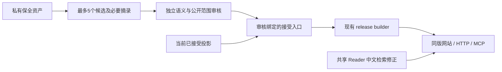

# VitaX 下一阶段 TDD：中文检索与已审旧知识增量

日期：2026-10-01。状态：proposed / ready for review；本轮只规划。

范围修正：用户同意将旧文章解读纳入本阶段，以下替代此前“仅旧Wiki”的限制。1,419篇原文章已私有保全；下一步补齐其合格解读的公开接入与验收，不重复迁移原文/译文。

本文是技术设计文档（Technical Design Document），同时定义测试驱动开发的红绿契约。产品方向沿用 ADR0003/0004；实施顺序见[阶段计划](../superpowers/plans/2026-10-01-vitax-reviewed-content-sprint.md)。不替代核心架构或另建 tracker。

## 1. 当前固定点与实际缺口

| 项目 | 已知范围与证据 |
| --- | --- |
| 当前公开版本 | `release-legacy-reviewed-20261001`：5来源修订、9知识、53证据、16实体、12关系；英语旧知识保留原语言 |
| 网站/MCP | 同一 FastAPI、同一 KnowledgeReader；六只读工具，默认20、上限100；21项针对检查与实际协议闭环已通过 |
| 私有保全 | 1,419成功文章、1,447修订；结构 passed 不等于事实审核或公开资格 |
| 旧 Wiki/图 | 90实体页中64占位、26富内容；仅一份旧 Wiki 的限定片段及一条关系获本轮审核；旧图保全不等于重建通过 |
| 缺口 A | 2026-10-01只读实测：HTTP/Reader 搜索“上下文”返回0；“上下文检索”返回1；现有标题/正文含“上下文”；只读原生字面SQL能找到7条，中文短词漏检可复现 |
| 缺口 B | 已审增量仍由源码外一次性脚本输出，硬编码材料/选择/基线；没有可供下一小批复用的正式接受入口 |
| 后置项 | 12缺正文、图片搬迁、其余语义审核、全图/高级检索、云发布、08:00日更未完成；不作为本小阶段的全量前置 |

本地事实来源：[迁移报告](/Users/hai/Projects/ohpc-migration/vitax-candidate-runs/legacy-migration-20261001T162719/REPORT.md)、[MCP验收](/Users/hai/Projects/ohpc-migration/vitax-candidate-runs/legacy-migration-20261001T162719/MCP-REPORT.md)。执行前刷新所用 release 和文件 hash；这些数量是本次快照，不是业务常量。运行服务 active/200 不能替代下述验收。

## 2. 本阶段产品结果

1. 访客输入中文短词，能找到公开知识标题/正文中实际包含该字面词的条目；网站、HTTP、MCP返回同样结果。
2. 维护者给出已有旧结构知识、精确必要引用和独立审核记录，能够重放成新公开投影；保留全部已接受基线。
3. 最多选择5个真实候选，覆盖旧文章已有解读与旧Wiki；逐项记录接受/待核/拒绝原因，目标为至少1份新增文章解读和1份新增Wiki形成真实可读release。不能用占位页或fixture凑数。

首要工作是“可用检索 + 可重放接受 + 小内容增量”。本阶段不做新引擎选型、全量知识重生产或部署。

## 3. 最小设计与边界



复用 SQLite、`_citations`、`_canonical_json`、`merge_accepted_articles`、`_validate_projection`、现有 builder。新增一个平直的旧知识接受模块即可；不新建数据库、编排框架、审核服务或多引擎接口。

### 3.1 中文查询

保持 `KnowledgeReader.search(query, limit=10, kind=None)` 签名、响应形状和现有参数校验。HTTP/MCP的默认20保持不变。

- 包含汉字（U+3400–U+9FFF）的查询走 SQLite `instr(title, query)` / `instr(body, query)`，按完整字面子串匹配，不拆词、不扩同义词。
- 标题命中排前，其后按 `knowledge_id` 稳定排序；`kind` 过滤在 `LIMIT` 前执行。
- 不含汉字的查询保留当前 FTS5 字面短语与 BM25 路线；英文专名、缩写、版本样例没有资料时允许零命中，不能伪造结果。
- 搜索范围仅公开 knowledge.title/body；不扩到私有全文、完整译文或全部来源正文。证据仍由既有工具显式读取。
- 百分号、下划线、引号和 FTS 运算符按数据处理；所有 SQL 参数绑定，禁止字符串拼接用户查询。

这是有意采用的小库扫描：代价为 O(公开文本量)。实施时留 `ponytail:` 注释说明该上限。只有实际公开库规模/延迟证明扫描不够用时才评估原生 trigram；本阶段不预建索引替换或向量服务。混合中英文仍按上述字面量规则，不承诺跨间隔拼词或语义召回。

### 3.2 已审核旧知识接受入口（拟新增）

位置：`vitax/reviewed_legacy.py`。单一纯函数：

```python
def compose_reviewed_release(
    *, artifact_bytes: bytes,
    standardized: Mapping[str, object],
    proposal: Mapping[str, object],
    review_record: Mapping[str, object],
    base_projection: Mapping[str, object],
    release_id: str, published_at: str,
) -> dict[str, object]: ...
```

返回 `{projection, acceptance_receipt}`，不读文件/数据库、不调用模型。CLI 只包装显式输入文件及新目录：

```text
python -m vitax.reviewed_legacy ARTIFACT PACKET REVIEW BASE NEW_OUTPUT \
  --release-id NEW_ID --published-at UTC_TIMESTAMP
```

`ARTIFACT` 由维护者明确提供，不能根据源文中的路径/指令自动跳转；只读获授权候选材料。PACKET包含 `standardized`、`proposal`；审核与源输入分开。NEW_OUTPUT必须不存在；接受完成后才写 `projection.json`、`acceptance-receipt.json`，失败不动已有包或基线。stdout仅计数/hash/状态，不打印私有搜索记录、原文或译文。该CLI不是网站/MCP管理工具。

### 3.3 审核与引用契约

沿用已经实际使用的独立审核记录字段：

| 字段 | 固定规则 |
| --- | --- |
| schema_version | 整数1；不是布尔值 |
| review_id/reviewed_by/reviewed_at | 非空身份和带时区审核时间；不从旧库补造 |
| artifact_sha256 | 原始 artifact bytes 的 SHA-256；CRLF等原字节不擅自规范化 |
| acceptance_input_sha256 | SHA-256(`_canonical_json({standardized, proposal})`)；复用当前规范，不另外实现 hash 编码 |
| selected_ids | knowledge/entities/relations 分组列表，组内无重复，ID必须在对应集合存在；不同集合ID命名空间独立 |
| languages | 恰覆盖所选知识ID，值en/zh且与proposal一致；原语言进入receipt，不伪标中文 |
| semantic_approved | 必须 `is True`；旧 `public/accepted/confidence/quality` 不是审核记录 |
| public_scope | 固定 `selected-knowledge-entities-relations-and-cited-excerpts` |

这些规则约束可信本地维护者的接受步骤，**不是签名系统，也不能由 hash 证明语义真值**。旧资料的自报字段或源内审核对象不能自动授权发布。完整原文/译文不能充当 Wiki；是否为实质结构知识、引用是否足以支持主张，由独立审核作出，程序不假称能认证事实。

- 本阶段接受 `kind=article` 的旧文章解读及 `kind=wiki` 的旧Wiki；所选knowledge列表必须非空，entities/relations可为空。保留en/zh，不改变新生产 `accept_model_output` 的中文要求。所有候选拒绝时不调用接受入口生成伪增量。
- 文章解读至少一份明确来源修订及准确引用，映射到已保全文章的稳定来源身份与修订。完整原文/译文、`body_rewritten`或其他派生全文不能因字段名称自动当作合格解读；须审核其实际结构知识、主张和公开范围。缺少已有合格解读时列为待生产，本阶段不自动重写或全量调用模型。
- 每篇 Wiki 至少两不同来源文档、两revision；同来源多版本不能凑数。来源身份沿现有source-aware映射，歧义保持待核。
- 所选知识/实体/关系逐项调用 `_citations`；拒绝缺引用、不匹配 quote、重复 revision/locator，不能信任输入 `evidence_ids`。
- 关系方向/类型必须在所选审核范围内；旧图 `source_id` 是chunk来源，不能当新关系端点。共同出现及完整 description 不能自动升级成关系事实。
- 实体必须有审核引用；关系端点只能是所选实体或基线公开实体。独立实体证据仍存receipt，当前SQL/API没有此证据字段，不宣称已支持独立实体来源接口。
- 仅实际引用的来源元数据与摘录进入增量；未知字段、未选条目、私有段落不进入投影；请求图片发布直接拒绝。依赖图片才能成立的主张保持待核。
- 五集合合并保留基线每条内容，重复相同ID/内容去重，冲突拒绝；最后校验公开闭包。固定输入及release元数据重放结果相同，不在纯函数内取当前时间。
- receipt记录审核、语言、实体证据ID、基线release/hash及结果计数。程序没有模型调用；原生语义审阅用量另记录，未知不填0。

CLI基线是维护者选定的当前 accepted 投影；执行前核其release与现存manifest/服务一致。阶段验收以当前95条五集合逐ID before/after hash保全为准，不能拿早期85条基线覆盖掉后来接受的Harness增量。

## 4. TDD 红绿契约

以下是待实施的检查，**不是本轮已运行或通过的测试**。优先复用现有单元/HTTP/实际MCP harness，新增约6个关键检查即可，不按每字段扩矩阵。

| 所属票 / 拟测试 | 首个应失败行为 | 最小修改及绿色结果 |
| --- | --- | --- |
| 009B1 `test_cjk_literal_substring_search` | 合成标题“上下文检索实验”，查询“上下文”目前0；“检索”短词也应命中 | Reader同一接缝内CJK字面子串SQL；正文/标题命中、稳定顺序 |
| 009B1 `test_cjk_kind_filter_precedes_limit` | 合成article/wiki均含短词，wiki+limit1不能被article截断 | 过滤在limit前；private哨兵不见，特殊符号不扩大结果 |
| 009B1 HTTP/MCP parity扩展 | 相同中文词、kind、默认/显式limit返回不一致即红 | 共用Reader；JSON、release一致；英文FTS既有检查不回归 |
| 009B2 `test_reviewed_legacy_preserves_base_and_language` | 新函数不存在/不能重放；英语被错误要求翻译即红 | 合成单源文章解读、两源Wiki和已审关系接受；fresh SQLite按article/wiki可查；五集合保全、英文不变、重复确定性 |
| 009B2 `test_unreviewed_or_changed_input_is_rejected` | 无独立审核、hash变化、quote不符或单源Wiki仍发布即红 | 少量参数例验证whole-call拒绝；单源文章仍可接受，不返回未选哨兵、不产生成功包 |
| 009B2 `test_publication_refuses_conflicts_and_existing_output` | 冲突覆盖、已有输出被写或失败留下成功结果即红 | 同ID冲突和已有输出拒绝，输入/前包字节不变 |

009B1的最小红例可用现有 `tests/unit/test_vitax_knowledge.py::_projection`：

```python
p = _projection()
p['knowledge'][0].update(title='上下文检索实验', body='索引前补充片段语境。')
build(p, tmp_path / 'public.sqlite')
with KnowledgeReader(tmp_path / 'public.sqlite') as reader:
    assert [r['knowledge_id'] for r in reader.search('上下文')['results']] == ['article-a']
```

绿色先跑改动所属小文件，再跑已有 `test_vitax_api.py` / `test_vitax_mcp.py`。所有离线命令用 `.venv/bin/python`、`OMNIGRAPH_LOAD_ENV=0`；该变量不清除继承凭据，fixture不得访问真实来源或网络。真实公开包的HTTP/MCP/浏览器检查另属009B3；不以直接调Python替代实际MCP协议。

## 5. 真实小批退出门

先只读核对既有私有候选的文章派生文本与来源映射，用确定性命令输出计数/ID/hash，不打印全文或把完整候选交给外部模型。选取已有文章解读及富内容Wiki，总计最多5个候选，至少各覆盖一项；排除64占位页。每项记录kind、源artifact/hash、文章身份/修订、引用解析、语言、审核决定与理由。单源文章可合格，单源Wiki、裸ref、缺解读/缺摘录、语义冲突均单列；不能为达到数量补造事实或第二来源。

通过条件：至少1份**新增**合格旧文章解读和1份新增合格旧Wiki进入新release；实体/关系只纳入明确获批项，不设新增数量。当前全部95条基线保留；私有字段不在DB/HTML/JS/HTTP/MCP出现；中文短词搜索→文章解读→原文章来源/证据、Wiki→跨来源证据、实体→关系→证据、刷新和移动端真实路径通过；article/wiki过滤与同版MCP/HTTP结果一致。新包是现有builder产物，失败保前版。

若文章解读或Wiki任何一类没有新增合格项，分别报告已完成范围与“新增内容未达完整门”；可保留已审合格增量及前版，但不把单类成功或全部拒绝当整票通过，不继续无界审核或自动调用模型重写。1419篇私有保全数与公开解读数分别报告；29份恢复artifact仍单独保全，12缺正文继续单列，不宣称全部文章已公开或所有正文已恢复。

## 6. 后续与不在本阶段做的事

内容门通过后复用VX-008做一台既有云机的手工候选发布，再推进VX-011日更；当前不选择或操作远端。高级检索/BYOLLM/全图裁决保持既有票，不提前删除LightRAG/Qdrant，不把SQLite关系读取称为图引擎等价。12缺正文、图片搬迁为单独已知缺口；SDK关闭日志没有当前功能/资源失败证据，不作为内容Sprint的升级前置。
