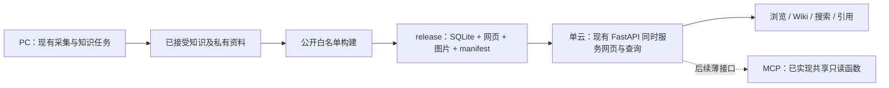
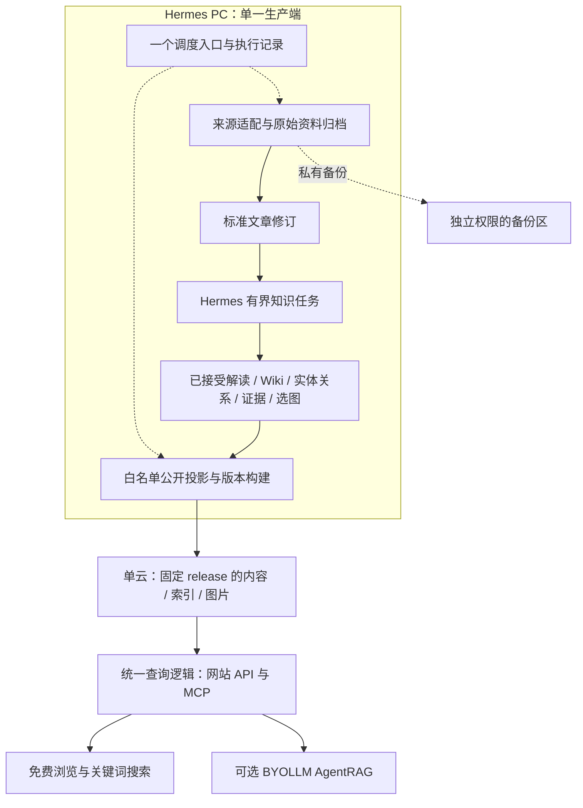

# VitaX 产品架构与执行计划

## 当前全局核查（2026-10-02，整改尚未实施）

用户随后要求Matt Pocock方法论的可执行规划，并Ponytail精简后落盘待执行。当前入口为[三模块执行计划](2026-10-02-vitax-three-module-execution.md) / [新规格](../../spec/VITAX_THREE_MODULE_EXECUTION_SPEC.md)，9张纵向工作票加一张存储取证决策，复用B1/B2/B3与008/011；以下核查及历史计划仍作证据/支线，不代表本轮已开工。

用户要求三个独立子代理核查采集/ingestion、storage/processing及VitaX网页，沿用[权威issue文档](../../../.planning/ISSUES.md)统一登记。核查已完成：当前初始化内存限流、failed重试契约、来源/正文覆盖、graph/KV及向量更新、Wiki建议消费、本地完整文章读取是相互关联的缺口。后续需按全局依赖规划；下方10/1最多5候选计划只涵盖公开知识支线，不能代替全部本地文章阅读或全局整改。私有本地阅读不以建图成功/公开accepted为前置，对外公开边界保留；本轮没有实施、生产变更或放开全文公网。

## 公开知识支线（2026-10-01，proposed）

本地网站/MCP、私有文章保全和限定旧知识增量已接受。下一块按[中文检索与可重放旧知识小批计划](2026-10-01-vitax-reviewed-content-sprint.md)和[TDD技术设计](../../spec/VITAX_REVIEWED_CONTENT_TDD.md)推进：B1实际中文漏检 → B2收成审核接受重放入口 → B3最多5个旧文章解读/Wiki候选的真实增量，目标各至少1新增合格项；B1/B2互不阻塞，B3依赖二者。用户同意补入旧文章解读，本段替代此前仅旧Wiki的范围；不重做1419篇私有保全、不自动公开原文/译文。当前只完成规划，不恢复实施或新模型内容加工。

该本地内容门之后再手工云候选和日更；不重做已迁1,419文章、不默认重建全图。下方早期云优先/已解除MCP阻塞仅作历史，以本段及阶段计划为当前顺序。

2026-10-01 修订。用户本轮已明确授权执行当前本地Reader收尾；已按最新AGENTS及Sol ticket技术裁决完成本地零图片切片。后续云端/迁移/切换按各自范围推进。依据 [ADR 0001](../../adr/0001-pc-production-cloud-serving.md)、[ADR 0002](../../adr/0002-autonomous-repair-authority.md)、[ADR 0003](../../adr/0003-product-architecture-over-legacy-parity.md) 和 [ADR 0004](../../adr/0004-minimal-knowledge-product.md)。本版替代先前 A–E 顺序及研究报告中不同的默认组件建议。历史验证保留原有范围，不等于生产就绪。

## MCP 接手结果（2026-10-01）

用户明确授权按任务性质使用6-Luna/6.1-Sol接手剩余编码；复杂集成由native Sol完成，Luna执行实际协议检查。当前本地Reader/MCP已共享六只读工具、同版结果；21项针对检查及真实客户端通过。旧DeepSeek取消阻塞作为历史保留；不改全局路由，不重跑数据迁移。详见[MCP验收](/Users/hai/Projects/ohpc-migration/vitax-candidate-runs/legacy-migration-20261001T162719/MCP-REPORT.md)。本地门完成不等于全图或生产发布完成。

## 最新批准与执行（2026-10-01）

用户批准将现有OmniGraph资产迁移/读库接入提前，先内容再云候选。[旧资产迁移与读库接入报告](/Users/hai/Projects/ohpc-migration/vitax-candidate-runs/legacy-migration-20261001T162719/REPORT.md)：私有成功文章候选保全及一个有证据的旧Wiki/实体关系公开增量已接受；MCP曾因既定coder通路取消BLOCKED，后已由用户授权Sol接手并通过本地协议验收。下方9/24–10/1早期云优先顺序作为历史保留，以本段新批准为准；不自动fallback模型、不把全图保全当全图重建。

## 0. 当前最简方案（hobby 项目）

[KNOWN] 2026-09-24 用户将本轮 destination 收窄为“用 ponytail 找一个最简化、适合 hobbyist 项目的解决方案”。本文继续作为唯一核心计划，不新建平行路线图；下方远期合同保留，但不再把全产品完成作为下一轮交付。

[INFERRED] 推荐 **PC 生产 + 一台云机只读服务 + 一个公开 SQLite + 一份站点构建产物**。先手工构建/发布，跑通后再给同一入口加每日 timer。私有原文与已接受知识保存在 PC；只复制通过公开边界校验的 release。失败时保留前版，先人工诊断，不建自动修复平台。

[KNOWN] 现有 `vitax.api.create_app(database_path, site_dir)` 已能同时挂载只读 API 和构建后的站点；`KnowledgeReader` 已有搜索、Wiki、证据和关联读取。因此不需要第二个 Web 后端、元数据数据库或站点重写。源码存在不等于打包、浏览器或云端验收已完成。

### Ponytail 逐项裁决

| 需求 | 第一个足够简单的方案 | 当前省掉什么 / 保留什么 |
| --- | --- | --- |
| 修旧 ingest | systemd 原生 MemoryHigh 3G→4G，硬上限仍5G | 不改算法、不换模型、不升级依赖；真实成功记录才算恢复 |
| 存储与知识关系 | 复用 SQLite 与已接受 artifact | 不引入数据库服务；保留来源、修订、引用和必要关系 |
| 页面与查询 | 复用 vitax-site 与一个 FastAPI 进程 | 不重写为另一套静态框架；不另建 BFF 或管理站 |
| release | 一个构建入口、一份 manifest、完整目录 | 不做平台化发布器；必须同版、拒绝私有材料、失败保前版 |
| 首次使用 | 先两源真实内容的本地站点 | 不把全库迁移、所有来源适配作为前置；旧资产继续保全 |
| 云端 | 复用一台已有主机及代理 | 不购买新资源、不新建集群；主机选择仍需现时证据 |
| MCP | 接现有读函数和 SDK | 不维护第二套搜索/权限逻辑；未声称已经接好 |
| 日更 | 手工入口通过后加一个系统 timer | 不上 Prefect、队列或第二套调度；最终08:00目标保留 |
| 高级检索 | 先用文章/Wiki/证据解决真实问题，缺口再做一组对照 | 新站暂不加载 LightRAG/Qdrant；不删除旧图或宣布功能等价 |
| BYOLLM | 后续复用有界查询循环 | 不成为首站发布前置；仍保留远期需求，不能默默取消 |
| 故障处理 | 明确失败、保存证据、保留可读前版 | 不建自愈框架；隐私校验、错误传播、备份恢复不精简掉 |

当前取舍是减少下一步的工作和运行依赖，不承诺已经减少现网主机或服务。旧 pipeline 在新路径验收前继续承担现有职责。

## 1. 产品目标与精简原则

[KNOWN] Hermes PC 是知识生产唯一写入端；一台阿里云提供 VitaX 专业知识站、MCP、已发布知识副本和私有备份，vitaclaw-site 保持独立站点边界。每天 08:00 Asia/Shanghai 发布；匿名浏览和检索免费，复杂问题可以 BYOLLM 深度研究。Wiki、KG、图片与来源引用是产品能力；用户希望日常无需介入。

[INFERRED] Ponytail 顺序：不需要的功能不建；复用有效现有代码；优先标准库和平台能力；最后才增加依赖或最小实现。衡量总代码、模型调用、运维与质量，不把服务数量作为唯一指标。旧 pipeline 是材料，不是兼容规范；同样不能把“重构”当成全部重写的理由。

## 2. 单一目标架构

以下为 [INFERRED] 设计，不是部署现状。

[INFERRED] 原始内容、人工修订和已接受知识输出是长期资产；配方用于溯源，不保证重跑出相同知识。公开投影、FTS、向量和图引擎内部文件可重建。每个字段有一个主写位置：稳定身份/版本选择由内容目录管理，内容 artifact 不变，读库是发布派生物；不另建第二权威图库或双向同步的 Wiki 主库。

| 逻辑对象 | 最小合同 |
| --- | --- |
| SourceDocument | 稳定来源身份、原/规范 URL 与别名；抓取事件可多次，不用内容相同抹掉不同来源 |
| DocumentRevision | 内容版本与 hash、解析配方、原始捕获关联、段落/页/图定位；来源发布时间与抓取时间分开 |
| KnowledgeRevision | 实际接受的解读、Wiki、主张/关系及引用；允许多个原文版本、多条支持/反证；保留人工改动与模型配方 |
| PublishedRelease | 选中的公开知识/证据/资源/索引版本、发布时间和 manifest；请求固定一个 release |

[INFERRED] 历史缺失时间、模型或定位信息保存 unknown/null，不补造。事实有效期、内容修订、来源发布时间与站点发布时间不同；缺失证据的旧关系先保留为待核知识，不伪装为已验证公开事实。

### 公开边界与发布

[INFERRED] 默认发布来源元数据、已接受解读/专题/Wiki、必要引用摘录和按价值选取的图片及出处 caption。完整原文/全文翻译、原始 HTML/PDF、账户、Agent 轨迹、后台日志及凭据不默认公开。实体/关系/引用必须全部落在同一公开集合；跨向私有或缺失证据时拒绝发布，不静默删掉引用制造无来源答案。

[INFERRED] 私有备份与公开包分开构建和授权，不能把私有备份放进 Web 可读目录。构建新不可变版本，校验文件和引用后整体提升；失败保前版。请求先固定 release_id，再解析其数据库、向量集合和图片。在途请求设硬性处理期限，超过期限终止，不以浏览器会话存活延长旧版本。每个公开版本有明确到期时间；到期后新请求返回410并提示刷新当前版本，在途请求期限结束后方可回收其服务资源。具体期限随目标服务配置固定，并以缩短期限的候选测试验证；不建立跨用户会话注册表。撤下内容立即撤销相关旧版本的公开读取并清理受控缓存，用旧URL拒绝与缓存响应作为证据；已被外部下载的副本无法召回。私有备份按独立保留策略保存，不随公开到期永久删除。hash 校验不等于发布者认证。

### KG、Wiki 与 AgentRAG

[INFERRED] SQLite 保存明确的实体、别名、类型关系、主张与证据关联；先提供有界邻接和证据读取。不预建任意多跳路径、社区分析、全局主题图或泛化属性系统。Wiki 是带修订和引用的知识页面，进入普通检索；按受影响主题更新，不默认每个实体一页，不声称模型加工是确定性真值编译。

[INFERRED] AgentRAG 是可选的深度研究入口：搜索 → 阅读 → 按需查关系/补证 → 引用回答。先复用现有有界循环和客户端能力，不强制多角色流水线，不增加 Agent 框架。查询工具返回证据，外层负责综合；总轮数、工具次数、候选数、上下文量、时间和访客模型预算分别有界。`top_k` 或 `only_context` 单独不能证明所有这些边界。

[INFERRED] BYOLLM 覆盖查询规划、关键词抽取、补查与答案等全部查询侧模型步骤；key 只用于当前请求/会话，不进日志、库或任务队列，失败不使用站点 Key。IP 限流保护主机资源，不能替代生成预算。网站及 MCP 共用 release 和证据逻辑；公网站点不暴露管理/写入工具或私有跨用户查询历史。“可选”指访客选择是否深度研究，不是可从项目验收删除该能力；基础站点/云端候选可以先关闭BYOLLM运行，最终产品验收与退役旧高级检索仍依赖VX-010。

## 3. 组件裁决：每一项必须说明替代什么

本表为 [INFERRED] 实施决策，不是尚未运行的性能排名。

| 组件 | 本轮决定 | 替代或节省 | 准入边界 |
| --- | --- | --- | --- |
| Python 标准库 SQLite/JSON/文件操作 | 用于首个公开构建/读模型 | 一个可重建读库；无元数据数据库服务和 ORM | 中文分词质量仍待实测；不能用英文命中证明中文检索合格 |
| 现有 FastAPI 与 MCP SDK | 接同一组读函数 | 避免网站/MCP 双份业务逻辑和额外后端 | 到站点切片再接；不为离线首片提前建服务 |
| SQLite 业务图 | 实体/关系/证据合同确定 | 业务知识不被某图引擎独占 | 只做产品需要的有界查询，不自制通用图引擎 |
| LightRAG | 保留隔离对照与可复用路径 | 如果胜出，替代自写实体/关系召回和融合 | 不自动暴露原生公网 API；版本/权限/公开投影必须复核 |
| 现有 Qdrant 与 embedding 路径 | 首条链不迁移；只作现有对照 | 避免同时改算法、向量存储、模型空间 | 新公开服务需独立于 PC；不把本地旧部署视为已达标 |
| sqlite-vec / FastEmbed | 延后到质量/资源证据要求时 | 通过后可替代向量服务或较重查询编码运行时 | 覆盖实际实体/关系/chunk 向量职责及编码兼容；不预写 LightRAG adapter |
| 现有 CDP/来源适配、HTML/PDF 解析 | 先复用可验证路径 | 避免先重写所有抓取器 | 发现正文/图/表质量缺口才比较 Trafilatura、Docling/MinerU 等；每类只留胜出路径 |
| Hermes 与现有 Wiki 实现 | 复用任务路线与有价值校验 | 避免第二语义运行时和通用 Wiki 编译平台 | 适配新 revision/证据合同，保护人工修订；不用旧 APPLIED 代替内容验收 |
| 单一现有调度入口 | 默认；候选先手动运行 | 没有必要先装工作流服务 | Hermes cron/系统 timer 二选一管理同一批次；核实主机后选择 |
| Prefect | 不再是前置或优先实验 | 只有能替代明确重复调度代码才引入 | 不同时维护原调度器；不扩展恢复框架 |
| 用户提供的 React/Vite/Tailwind 站点 | 审阅后接真实数据 | 复用 UI，不另写一套站点 | 无 mock 成功回退，文章/Wiki/引用有可访问 URL，验证预渲染和 SEO |

[INFERRED] 当前不新增 Neo4j、Postgres、Cognee、RAGFlow、LangChain/LangGraph、Temporal、Celery/Redis、事件总线、实时复制或通用插件层。现有 SQLite 目录与 Qdrant 向量职责不同，不能只按“两种数据库”判定重复；最终不长期双跑两个相同职责的生产引擎。

## 4. 当前执行顺序与停止点

[KNOWN] 两源知识/Wiki、20篇私有导入和读模型有历史局部验收；当前工作树已有 API/站点/公开边界 WIP。9/24交接时release builder与浏览器UAT尚缺；10/1已新增最小builder并完成真实本地浏览器闭环，见[2026-10-01本地验收](/Users/hai/Projects/ohpc-migration/vitax-candidate-runs/reader-release-20261001/REPORT.md)。不把此前测试次数或文件存在当成新的产品验收。

| 顺序 | 复用工单 | 最小交付与退出门 |
| --- | --- | --- |
| 当前运维 | VX-005 所涉旧 pipeline | 单篇恢复已验证：新增ok id=66988；完整批次/下次调度未验收，见[证据](../../deployments/2026-09-24-ingest-recovery/EVIDENCE.md) |
| **本地门已完成** | VX-007A、VX-009A1 → VX-009A2 | 2026-10-01 local accepted：复用WIP，真实两源零图片包/浏览器/隐私检查通过；源码外稳定产物见验收报告 |
| 本地验收后 | VX-008 的基础候选 + VX-009 MCP | 选一台已有云机，手工发布同一包；PC离线仍可读；坏包保前版；不混入无人值守改造 |
| 手工发布通过后 | VX-011 | 同一个生产/发布入口加每日08:00 timer；一次真实日更及失败保前版；无需工作流平台 |
| 有真实内容需求时 | VX-012C、VX-009B | 复用已存在导入入口，零LLM私有导入；仅获公开资格的知识接入读者站，不批量重做全部历史模型加工 |
| 有明确检索缺口时 | VX-010 | 用固定真实问题验证图/向量/有界补查的收益；BYOLLM有预算、凭据和引用边界；单独验收，不宣布已被普通搜索替代 |
| 最终，单独授权 | VX-012生产切换 | 增量对账、恢复演练、新旧职责交接后才停旧服务；不因简单架构图提前退休旧数据或主机 |

[INFERRED] 下一执行包限定为现有 Reader Sprint 的收尾。直接复用其规格和三张工单，不另拆一套实施票；默认一名实现者、一名独立审阅者，确有互斥工作才并行。通过本地 release/UAT 即停止，不自动延伸到全库迁移、云部署、BYOLLM或生产切换。

[KNOWN] 9/24为旧pipeline修复/规划；10/1用户新授权使本地Reader收尾完成。没有恢复旧goal；本轮在上述本地门收口，云端/日更/迁移未实施。

## 5. 最多三个决定性验证

1. **真实知识生产质量。** 从已有来源取一篇贯通，再扩到约12篇中英/HTML/CDP/PDF/图表资料；以关键正文、数字、图片及引用预期验收解读、关系、Wiki更新。只对失败的解析/任务边界做小对照，不跑框架全排列。复用已有有效输出，记录实际用量或 unknown。样本规模不是统计充分性声明。
2. **检索与 AgentRAG 的增益。** 固定同一公开资料及独立审阅的参考证据，比较文章/Wiki基线与现有图增强，再只对有价值路径比较直接问答和有界补查。覆盖专名、缩写、版本、多跳、冲突、无答案；记录错引/漏证、延迟、模型费用、云端资源。需要替换向量或模型时先保持其它变量一致。结果决定引擎，不预设 LightRAG 必须退役或必须保留。
3. **发布与无人值守闭环。** 真实候选 release 上验证重复触发、阶段复用、坏版本拒绝、上一版继续可读、请求不混版本、PC断开云端可用、08:00时区、额度暂停、撤下内容不经旧URL泄露，以及私有备份恢复。只修实证缺口，不扩写通用恢复平台。

## 6. 迁移与执行边界

[INFERRED] 迁移、质量筛选、公开资格三种状态独立：原始资产全部保全；零LLM规则检查正文有效长度、壳页、重复和疑似译文残缺，输出原因和规则版本。200字符只沿用为初始短文提示，阈值由实际分布/样本校准；短公告、代码和图表不因长度自动淘汰，结构合格不等于专业价值或翻译质量已认证。筛选后引用不得悬空。

[INFERRED] 单篇、小批、全量和后续增量共用入口、稳定映射和进度记录，不建第二ETL/目录库。迁移模型请求为0；既有知识/译文直接保留。补翻译/知识加工另排队，按内容hash、任务、语言及模型/prompt/schema版本复用已接受结果，只处理变化或缺失项，未知用量不填0。

[INFERRED] 旧库是只读导入来源。先选小批现有文章/翻译/Wiki/图片/关系，与新内容进入同一合同；记录旧 ID/URL 到新 doc_id 与 revision 的映射。保留冲突、人工修订和多来源，不因 hash 相同删除出处。不兼容的索引再派生；不要求用新模型重算全部历史资产。无证据旧关系保留待核，不进入已验证公开事实。

[KNOWN] 编码采用用户要求的主控决策/拆分/验收、子代理执行；只派互斥写范围。当前目录有大量整理 WIP，保留原状；不得自动 commit/push、永久删除原始数据、不可逆迁移、改凭据或增加付费资源。生产变更绑定具体工单和当前验收，不整目录覆盖远端。

[INFERRED] 收口原则：首片通过就推进真实内容，不能为了更多 passing counts 重复合成探针。后续新组件必须写出它撤掉哪段代码/服务、改善哪个实际指标，以及不采用时的简单路径。

## 7. Wayfinder 决策地图

Label: `wayfinder:map`

Status: charted；只规划，未解决后续决策票。

### Destination

为一个人维护的 hobby 知识项目选定最简可持续方案，并明确从现有 WIP 到可用读者站的第一步。依据用户本轮 hobbyist/ponytail 纠偏；完整云端日更和高级检索是分段推进的后续目标。

### Notes

使用 wayfinder + ponytail。已确认的权限、公开边界和产品目标沿用 ADR，不重复开票。本文是核心计划及地图索引；决策细节只放对应 child ticket。沿用现有 `docs/work-items/vitax-refactor/`，不重建归档 `.scratch` 工作流；`.planning/ISSUES.md` 保存前沿及依赖状态，`Parent / Type / Status / Assignee / Blocked by` 表达本地 tracker 关系。

### Decisions so far

本轮为 chart 阶段，没有把待证实的云机选择或检索收益写成已解决。此前已确认方向见 ADR0001–0004；当前推荐与 ponytail 取舍见第0节。

### Not yet specified

实际使用后再确定来源频率、代表内容规模，以及哪些失败值得自动恢复。现在没有实测依据，不先为每个假想场景生成工单。

### Out of scope

10/1已按新授权完成现有本地Reader；本轮不全量迁移、不替换查询引擎、不删除旧资产、不关闭旧服务。无新集群、数据库服务、调度框架或自愈平台。
