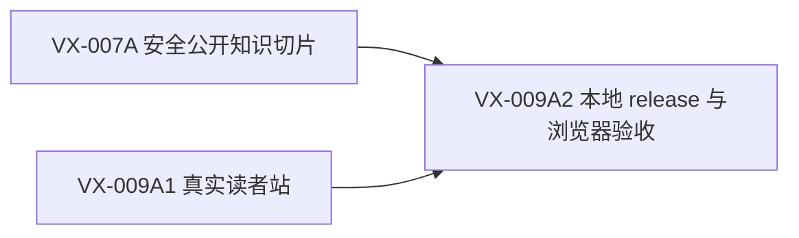

# VitaX Reader + Safe Public Knowledge Sprint

**状态：** local accepted（2026-10-01；当前零图片切片）  
**方法：** ask-matt 规格→票→实施；ponytail 在第一个能成立的层级停止增加复杂性。

## Sprint 目标

[INFERRED] 用现有两来源 release 和 `KB-v2-site.zip`，在本地交付一个真实、可刷新、无 mock、不会公开全文原文/译文的 VitaX 读者站，并生成可复制到云端的最小 release 目录。

## 为什么现在做

[KNOWN] VX-012B 已完成 20 篇零 LLM 私有导入、幂等和保全；公开投影尚未验收。[KNOWN] 当前迁移投影会把完整译文变成公开知识正文和逐段证据。[INFERRED] 因此“安全公开合同 + 真实读者站”是全量迁移、云发布和 BYOLLM 的共同前置，也是当前最短产品路径。

## 交付 DAG

VX-007A 与 VX-009A1 可并行；VX-009A2 只做集成和验收，不重写前两票。

## 实施顺序

### 0. 主控校准

- 固定真实证据 release 为 `release-20260910t021435z`。
- 将 20 篇导入状态更新为“私有迁移已通过、公开资格未通过”。
- 保存工作树前态；保护无关 WIP。

### 1A. VX-007A — 安全公开知识切片

- 先写会失败的隐私边界测试。
- 将迁移记录与公开知识产物解耦：完整原文/译文只留私有；公开正文必须来自显式 accepted knowledge/Wiki。
- 必要证据只按 accepted 引用进入公开库，禁止自动逐段公开全文。
- fresh process 验证读库、release 一致性与 sentinel 不泄露。

### 1B. VX-009A1 — 真实读者站

- 解包并审阅 ZIP，复用视觉与已有 React/Vite/Tailwind 结构。
- 删除 mock、假统计、评审/设计/反馈工具和不可用动作。
- 接现有读模型的最小 HTTP 查询，实现列表/搜索、文章、Wiki、证据四类界面。
- 实现真实 404、空态、错误态、移动端和键盘主路径。

### 2. VX-009A2 — 本地 release 与浏览器验收

- 生成 `{public.sqlite, site, images, manifest}` 最小目录。
- 验证列表→文章→证据、Wiki→两来源、搜索及刷新直达。
- 扫描交付字节与 HTTP，确认私有 sentinel、完整原文/译文不可达。
- 独立审阅结果；仅修本 Sprint 引入的失败。

## 角色和派工边界

| 角色 | 任务 | 允许范围 | 禁止范围 | 返回 |
| --- | --- | --- | --- | --- |
| controller | 校准、拆分、最终验收 | tracker、证据索引、整合判断 | 代替独立审阅 | STATUS/CHANGES/EVIDENCE/RISKS/NEXT |
| coder | VX-007A 或 VX-009A1，分配互斥写范围 | 对应代码、测试与该票证据 | 凭据、运行数据、远端、模型 | 同上 |
| reviewer | 公开边界与实现审阅 | 只读代码和测试证据 | 修改生产状态 | 同上 |
| uat | VX-009A2 浏览器验收 | 本地服务、DOM/网络/截图证据 | 最终接受、远端部署 | 同上 |

[KNOWN] 按当前模型路由，`coder` 使用 DeepSeek Flash，仅允许最小化的仓库代码与合成/公开 fixture；`reviewer` 和 `uat` 使用 Terra。主控等待所有子代理终态、检查证据并关闭后才能接受。

## 停止条件

- 出现需要公开完整原文/译文才能满足页面的设计，停止并回到产品合同。
- 同一问题两次逻辑修复失败，保存首个完整错误和新证据，回主控重新判断。
- 任何远端、模型、生产或凭据依赖都视为越界，不用替代路线绕过。
- 三票验收通过即停止；不顺手加入 BYOLLM、向量检索、全量迁移或云端原子切换。

## 后续，不属于本 Sprint

验收后依次推进 VX-012C 全量私有候选、VX-009B 统一旧知识查询、VX-010 BYOLLM、VX-008 云发布与 VX-011 日更。只有基础站点的真实问题证明需要新组件时才准入。

## 当前执行结果

[2026-10-01本地验收](/Users/hai/Projects/ohpc-migration/vitax-candidate-runs/reader-release-20261001/REPORT.md)。本轮复用前三票已有WIP，仅补最小builder、404及相对输出修复；22项针对检查、7组固定浏览器检查通过，Sol复审无剩余P1/P2。旧角色表中的Terra是历史说明，执行时遵守2026-09-30现行路由：Sol技术裁决/审阅、DeepSeek coder、Luna uat；子代理不派孙代理。
