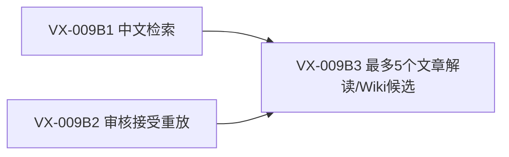

# VitaX 下一步实施计划：中文检索与可重放旧知识小批

> Agent执行：批准后按 `executing-plans` 或有明确互斥范围的 `subagent-driven-development` 逐票推进。用户AGENTS的MVP、模型/工具面、失败及无自动commit规则优先；当前仅规划。

状态：proposed / ready for review。日期：2026-10-01。

2026-10-02：本文仅保留为公开知识B1/B2/B3支线；全局次序、本地完整文章库与三模块闭环以[三模块实施计划](2026-10-02-vitax-three-module-execution.md)为准。最多5候选不是全量文章阅读的完成门。

**Goal：** 让中文短词检索可靠命中已发布内容，并把下一批最多5个旧文章解读/旧Wiki候选中审核通过的知识稳定接入现有站点/MCP。

**范围修正（用户同意）：** 此版替代此前仅旧Wiki的内容范围。原1419篇文章/1447修订已私有保全；下一步同时验收旧文章解读的公开接入，保留原文、译文及派生全文的私有边界。本次更新为计划修正，尚未实施。

**Architecture：** 保留现有单一Reader、SQLite和FastAPI。中文查询用原生字面子串SQL；将已成功的一次性接受脚本收成平直模块，继续调用既有引用、合并、闭包与release builder。

**Tech Stack：** Python/SQLite标准库、现有FastAPI/MCP1.12、React/Vite；不新增框架或服务。

**Spec：** [TDD技术设计与红绿契约](../../spec/VITAX_REVIEWED_CONTENT_TDD.md)。总方向仍由[核心计划](2026-09-09-vitax-product-architecture.md)及ADR0003/0004管理。

## 现状与为何这样排序

Reader及MCP已本地接受；现有公开版本只有9知识，1,419文章是私有保全而非全部可公开。现状只读实测“上下文”0命中、“上下文检索”1命中，先修共享检索的实际缺口。旧知识接受已成功一次，但材料与选择硬编码；下一小批是真实复用需求，适合收成一个最小入口，而不是建审核平台。

旧图106,752节点/199,936关系、26富内容Wiki不自动accepted。先增长可查、可追溯内容；暂不发布只有少量内容的云站，不全量重跑模型或补齐所有缺资产。

## 全局约束

- 原地保留WIP、旧库、原始材料及前版；不worktree/reset/stash/commit/push。
- 本地与离线fixture为默认；真实材料仅在源码外既有候选根，只读来源。计划写入不构成实施、远端或新模型内容加工授权。
- 不重做1,419文章保全及已过MCP闭环；只针对新增行为检查。没有新的失败，不增加全套/跨引擎/重复UAT。
- 代码/fixture不含真实私有全文、凭据或PII；语义审核仅用获准的最小公开技术候选和必要摘录。原文/译文不自动生成公开知识。
- 沿用户当前Luna/Sol偏好：Sol处理有实质行为的集成及只读技术裁决，Luna承担机械材料整理/既定断言执行。普通过滤/计数直接用命令。
- 派工先证实工具面；纯文本default角色不能做shell任务；fresh子代理不另建app task或孙代理。默认并发2、上限4；同一worker做后续修复。
- 现有coder/debugger角色绑定DeepSeek，不因角色名误绕当前授权。失败DeepSeek路线不自动恢复；不改global routing/TOML或新增fallback。
- 首错完整保存，两次逻辑失败停止该分支；传输失败与产品失败分开。hash/config/自报/HTTP200不单独当PASS。

## 三票与真实 blocking edges

| 票 | 前置 | 独立可验收交付 |
| --- | --- | --- |
| [VX-009B1](../../work-items/vitax-refactor/VX-009B1-cjk-lexical-search.md) | 当前Reader/MCP本地门，已完成 | 中文短词在Reader/HTTP/MCP/站点一致可查 |
| [VX-009B2](../../work-items/vitax-refactor/VX-009B2-reviewed-legacy-replay.md) | 当前审核增量与构建接缝，已完成 | 一个有审核绑定、可重放、失败不覆盖的接受CLI；合成数据可fresh读取 |
| [VX-009B3](../../work-items/vitax-refactor/VX-009B3-reviewed-content-batch.md) | B1+B2 | 最多5候选审计，至少1新增旧文章解读和1新增旧Wiki；新包/网站/MCP引用闭环及前版保全 |

B1/B2写范围互斥，可以并行；hobby默认串行，避免多座位反复加载。B3只组合已完成接口，不再重写站点或第二迁移入口。

## Task 1 — VX-009B1 中文字面检索

**Modify：** `vitax/knowledge.py`，`tests/unit/test_vitax_knowledge.py`；按实际需要扩展 `tests/unit/test_vitax_api.py`、`tests/unit/test_vitax_mcp.py` 的同版检查。

**Consumes：** 当前公开schema-v1；现有 `KnowledgeReader.search(query, limit=10, kind=None)`。

**Produces：** 签名/响应不变；汉字query按TDD字面子串规则匹配，英文仍走FTS。HTTP/MCP默认20及上限100不变。

- [ ] 写TDD第4节中文短词红例，确认当前实现为0、测试因漏检失败。
- [ ] 在共享Reader内做原生`instr`查询，kind先于limit；标题优先、ID稳定。不分别修API/MCP，不引入分词服务。
- [ ] 验证短词、kind+limit、私有哨兵/特殊字符和原英文路线；写明`ponytail:`扫描上限。
- [ ] 小文件通过后运行 `.venv/bin/python -m pytest tests/unit/test_vitax_knowledge.py tests/unit/test_vitax_api.py tests/unit/test_vitax_mcp.py -q`，环境 `OMNIGRAPH_LOAD_ENV=0`。

## Task 2 — VX-009B2 复用已审核接受流程

**Create：** `vitax/reviewed_legacy.py`、`tests/unit/test_vitax_reviewed_legacy.py`。必要使用说明随同模块交付；不修改新生产中文规则或私有导入公开边界。

**Consumes：** 原artifact bytes、standardized/proposal、独立review_record、当前accepted base；接口精确见TDD §3.2/3.3。

**Produces：** `compose_reviewed_release(...) -> {projection, acceptance_receipt}`；同模块CLI写两个结果文件，后续直接交现有builder。

- [ ] 用synthetic单源文章解读、两源英文Wiki+关系写缺入口红例；不复制真实原文进fixture。
- [ ] 抽取并复用当前一次性脚本中的字段转换，调用现有引用/合并/闭包校验；不发明审核记录或事实。
- [ ] 用少量反例锁住无审核、hash/quote变化、单源Wiki、冲突、未选私有字段、已有输出保全；单源文章可接受，输入不变、固定元数据重放一致。
- [ ] 运行 `.venv/bin/python -m pytest tests/unit/test_vitax_reviewed_legacy.py -q`；用新synthetic输出fresh构建SQLite读取，再保留针对性结果。不得用assert-only守卫替代正式运行时拒绝。

## Task 3 — VX-009B3 下一批真实可读知识

**Writes：** 仅新源码外候选/审核/结果/证据目录，以及本票/EXECUTION状态；若发现产品失败只回相应B1/B2修复。

**Consumes：** B1查询、B2接受CLI、当前accepted投影；现有 `scripts/build_vitax_release.py`、`vitax.api` 及实际MCP/client/browser harness。

**Produces：** 新不可变release与逐项审计，文章私有保全数、公开解读数、Wiki数分开报告；失败保前版。实施前核当前release/hash，不固定假设永远9知识。

- [ ] 先只读核旧文章已有派生内容与来源/修订映射，仅输出计数/ID/hash；从已有文章解读和富内容Wiki取最多5候选，至少各覆盖一项，不取64占位凑数；缺已有解读列待生产，不自动调用模型重写。
- [ ] Sol在获准最小材料上独立审核，记录所选知识/实体/关系、双hash、语言及必要公开范围；单源文章可合格，Wiki须两不同来源。至少1新增合格文章解读和1新增合格Wiki，否则分别报告完成范围及未达完整门。
- [ ] 通过B2逐条合并到当前基线，保全全部五集合；调用既有builder，公开包只放所选知识和必要证据，不带private/review原材料。
- [ ] 实际站点搜索中文短词与新增词→文章解读→原文章来源/证据、Wiki→跨来源证据，实体→关系→证据、刷新与一个手机视口；article/wiki过滤及实际SDK MCP同query/同release/同JSON，私有路径拒绝。
- [ ] 检查逐ID基线hash、包完整hash及source保全，全部子代理终态并关闭，按STATUS/CHANGES/EVIDENCE/RISKS/NEXT收口。

## Review Focus 与停止点

最多约6项关键新检查，具体在TDD §4；重点是真实漏检、过滤前置、伪审核/hash漂移、来源歧义、英文被重译、基线/前包丢失。现有边界无变化不重写一套测试。

任何无证据知识、CLI读取未授权路径、自动发布全文、同源多版本凑两来源、模型/provider失败，分别停相应分支；不为满足数量改验收。任一类没有新增合格项时保留审计/原版，报告缺口，不宣称整票通过。29恢复artifact/12缺正文仍单列，不将其混入已完整恢复的正文计数。

## 后续顺序（不是本轮实施包）

本阶段通过 → 复用VX-008基础候选，刷新目标事实并选一台已有云机手工发布 → VX-011复用同入口08:00日更。云端权限/备份/回退合同单独验收；本阶段不自动连接、部署或重启。高级检索/全图/BYOLLM只在真实问题与既有产品合同下推进，不为了“重建”重抽取全部历史资产。

规划完毕后的实施应按票使用新鲜上下文，引用本计划/TDD/当前checkpoint；不把饱和父历史传给所有子代理。用户可据这两份文档批准下一执行包，本轮尚未实施或运行上述未来测试。
