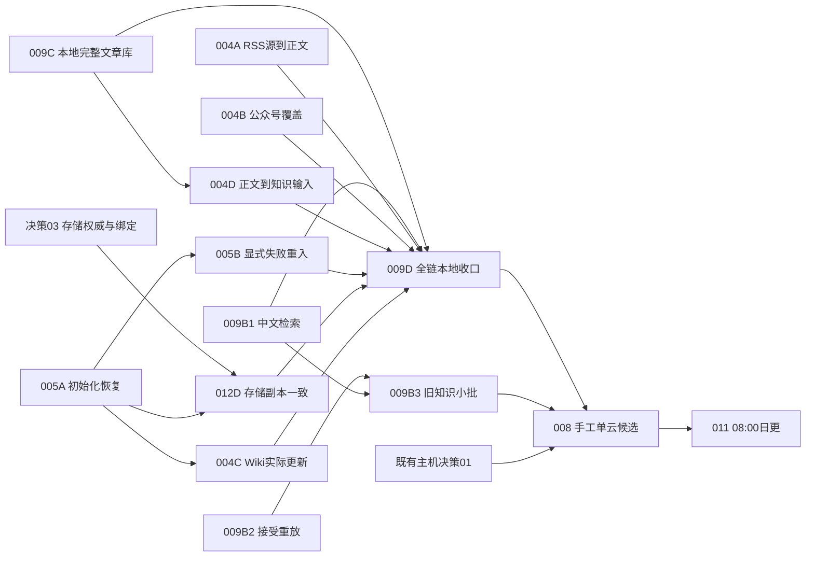

# VitaX 三模块整改实施计划

> For agentic workers：执行批准后逐票使用 Matt `/implement` 的红→绿→规格/标准审阅，或既有 `executing-plans`。用户AGENTS、模型/工具面纪律及不自动commit规则优先；当前仅落盘规划，**待执行**。

**Goal：** 持续获得可读资料，贯通本地完整文章阅读，恢复知识/Wiki与一致存储交接，再验收同源知识发布和日更。

**Architecture：** 沿用现有采集链、SQLite、LightRAG/Qdrant过渡实现、Wiki worker、FastAPI和React。给现有应用显式配置一个本地只读文章来源；公开Reader/MCP继续只读已接受release。修具体交接合同，避免另造三套平台。

**Tech Stack：** Python3.12/SQLite/JSON标准库、现有FastAPI/MCP1.12、React/Vite、既有Hermes与Qdrant原生能力；不新增依赖。

**Spec：** [三模块规格](../../spec/VITAX_THREE_MODULE_EXECUTION_SPEC.md)。既有[B1/B2/B3技术契约](../../spec/VITAX_REVIEWED_CONTENT_TDD.md)作为公开知识支线复用。

状态：proposed / ready-for-review。日期：2026-10-02。固定源码HEAD=`8505dbca4958944fc08b0ea5ebdf88f9051a7bfa`，分支`vitax-refactor-snapshot`且已有大量WIP；现场事实来自10/2核查，不假定执行当天仍相同。

## Matt 方法论与当前裁决

已完成问题探索、三独立代理核查及本地/公开边界澄清；本次走 **to-spec→to-tickets**，不重新访谈既有决定，不重复triage自己创建的票。存储绑定仍有实证未知，用一张有明确输出的决策票解决；不先写猜测实现。每张工作票交付完整可演示路径，数据/UI/验证不拆成横向工单。

原10/1“最多5候选”只解决已审公开内容，保留但不再作全局主线。本地读取全库与生产修复可并行；不能把先修图/先审核全文变成本地阅读前置。

## Global Constraints

- 本轮文档不执行命令中的生产/模型动作。执行批准仍须遵守各票具体写范围；额外额度、不可逆删除、身份凭据与未知数据归属不因笼统“执行”获得授权。
- 原地保全WIP，不reset/stash/whole-tree部署，不自动commit/push；测试用`.venv/bin/python`、`OMNIGRAPH_LOAD_ENV=0`，该变量不清继承凭据或隔离网络。
- 真实库、captures、receipt及镜像在源码外私有目录；默认`~/.hermes/omonigraph-vault`拼写保留。只输出计数/ID/hash/脱敏错误，不dump正文、译文、账户或凭据。
- 远端前读部署基线；每次SSH先guard hostname。ack-node-2=pipeline/iZj1imk39yc55iZ，ack-node-1=MCP/ack-node-2-kg，OHPC=Hermes/OH-Desktop。保留fork、Vision及远端WIP，先备份/parse候选，精确文件同步、hash和回滚。
- 正常并发2，上限4含sidecar；同一源码文件/SQLite迁移/远端写入不能并行。R1/R2共享ingest范围，R3/B1共享前端/API测试时串行。
- 复杂L票由用户授权的**6.1-Sol票级主控**在新鲜原生上下文执行；Luna处理机械材料/既定断言，S票可Luna。先核文件写入、shell、SSH和浏览器工具面；当前固定Sol reviewer是只读，不能当编码主控，coder固定DeepSeek也不能偷偷覆盖。可用的原生Sol写席必须实际存在，否则BLOCKED；不改角色TOML或换harness绕过。
- 模型执行留request-correlated usage证据；不恢复失败的Codex DeepSeek coder路线，不因它失败替换仍正常的业务provider。子代理无孙代理，fresh有界packet；结果STATUS/CHANGES/EVIDENCE/RISKS/NEXT，复用跟进，inspect/wait/close后收口。
- 首错完整记录，一次证据支持的最小修复；同分支两次逻辑失败停止。transport/provider单独计，不当产品失败；未经相应真实调用不能写PASS。

## Review Focus

1. R3：无ingestion/failed/Layer2 reject仍能本地读，默认公开模式与MCP拒绝私有全文。
2. R2：同ID异来源不会互相解锁，初始化失败不消耗retry请求，再失败不会无限重入。
3. R6：目标历史额外数据不删除，同版图/KV与向量关系成立，候选成功不冒充已服务。
4. R7/R8：占位/未解析source/派生全文不冒充accepted知识，时间/hash/quote真实。
5. R9：完整覆盖、坏包保前版、重复运行不再加工、既有额度失败不换provider。

## 依赖图与frontier



初始frontier：R1、R3、B1、R4、R5和决策03。**推荐顺序：R1与R3两个席；B1随后；R2→来源修复→存储/Wiki→R8→R9；B2/B3嵌入公开支线。** R8复用R3的原文读取接口，真实阻塞边为R3→R8；R4/R5可先离线实现，若需要主ingestion运行，验收用R1门。

| 切片 | 对应issue | 风险/主控 | 完成交付 |
| --- | --- | --- | --- |
| [R1 VX-005A](../../work-items/vitax-refactor/VX-005A-ingest-init-pressure.md) | #93 | L / Sol | 实测根因与最小修复，真实批次及下次timer |
| [R2 VX-005B](../../work-items/vitax-refactor/VX-005B-failed-reentry.md) | #94 | M / Sol | 受控失败请求只重入一次 |
| [R3 VX-009C](../../work-items/vitax-refactor/VX-009C-local-article-library.md) | #99 | L / Sol | 原库→本地API→文章列表/原文/译文/续读 |
| [R4 VX-004A](../../work-items/vitax-refactor/VX-004A-rss-source-and-body.md) | #96/#97 | M / Sol | RSS有效源及一旧一新正文到分类 |
| [R5 VX-004B](../../work-items/vitax-refactor/VX-004B-wechat-coverage.md) | #95 | M / Sol | 目标名单按约定周期可对账覆盖 |
| [R6 VX-012D](../../work-items/vitax-refactor/VX-012D-storage-convergence.md) | #98 | L / Sol | 同版存储候选与有回滚的读取绑定 |
| [R7 VX-004C](../../work-items/vitax-refactor/VX-004C-wiki-evolution.md) | #5 | L / Sol | 一建议实际正文/证据变化和幂等 |
| [R8 VX-004D](../../work-items/vitax-refactor/VX-004D-stored-source-production.md) | 新旧生产交接 | M / Sol | 已存正文→一篇accepted新解读；两源Wiki复用 |
| [R9 VX-009D](../../work-items/vitax-refactor/VX-009D-three-module-acceptance.md) | 汇总门 | M / Sol+Luna断言 | 同源采集→文章→知识/图/Wiki→HTTP/MCP可读 |

## R1 — VX-005A 当前批次初始化恢复

**Files：** 查`ingest_wechat.py::get_rag`、`batch_ingest_from_spider.py::ingest_from_db`、实际LightRAG storage与unit/drop-ins；仅证据指向的源码/资源项可改。代码变更回归优先`tests/unit/test_ingest_from_db_orchestration.py`和`_ingest_fixtures.py`，必要时新增一个init contract检查；只改合法资源配置则不写镜像式测试。

**Interfaces：** 保持`get_rag(flush=True)`及ingest_from_db入口；输出`init-recovery-receipt.json`安全字段为host/source SHA、首阻塞阶段、RSS/cgroup序列、候选数、新ok ID、批次退出、next_timer_result与变更/回滚。

- [ ] 刷新pid/cgroup/阶段日志与实际包版本，核现在是否仍为同一初始化压力；已外部恢复则只验证，不重复修复。
- [ ] 用现有proc/cgroup/阶段接口区分图解析、JSON/cache/向量加载等分配热点；不启动第二个真实写入RAG实例作“诊断”。先写一条可复现的失败命令/证据，确定最小变更；无法定位则交证据并BLOCKED，不凭猜测加框架。
- [ ] 逻辑变更做一个真实入口红→绿；配置变更用owner-native备份/parse/apply，保留业务provider/原数据。2026-10-02用户已明确授权必要扩容，允许有界调整软/硬限制；已实施5/6 GiB，原timeout/prestart不变，须说明实测余量与增长上限并另验真实运行。
- [ ] 若触及ingest契约，运行`OMNIGRAPH_LOAD_ENV=0 .venv/bin/python -m pytest tests/unit/test_ingest_from_db_orchestration.py -q`并同步fixture schema；不运行会隐式重启的healthcheck。
- [ ] 原入口跨过初始化、处理并完成当前批次，新增真实ok；观察下一既有timer也能通过。仅一次单篇成功记partial，不能再次当长稳门已关闭。

## R2 — VX-005B 显式失败重入

**Files：** `scripts/reconcile_ingestions.py`、`batch_ingest_from_spider.py::_build_topic_filter_query`、`migrations/012_ingestion_retry_requested.sql`、`tests/unit/_ingest_fixtures.py`；扩展已有reconcile/orchestration两个测试文件。

**Interfaces：** `ingestions.retry_requested INTEGER NOT NULL DEFAULT 0 CHECK (... IN (0,1))`；reconcile明确请求置1，普通failed保持0；实际正文尝试前UPDATE原子消费，后续INSERT OR REPLACE默认0。

- [ ] 红例：同数值ID分别来自微信/RSS，仅受控假成功被请求；当前版本的请求仍可进入，普通failed和ok不能进；初始化失败标记保持1。
- [ ] 幂等schema升级保留行ID/字段/唯一约束；先schema再代码，不对缺列静默fallback。reconcile只修改自己已确认且授权auto-patch的范围，成功排除和stale skipped规则保留。
- [ ] consume→一次正文尝试→再失败标记0；reconcile请求重复设置是幂等的，不能删除原记录或批量解锁258 failed。
- [ ] `OMNIGRAPH_LOAD_ENV=0 .venv/bin/python -m pytest tests/unit/test_reconcile_ingestions.py tests/unit/test_ingest_from_db_orchestration.py -q`；随后选一个明确可恢复记录实际读回，运行门依赖R1。

## R3 — VX-009C 完整文章本地阅读

**Create：** 一个平直`vitax/local_articles.py`和`tests/unit/test_vitax_local_articles.py`；前端一个`LocalArticlesPage.tsx`负责列表/详情。**Modify：** `vitax/api.py`、现有types/api/routes/App/Header及对应已有tests；不修改kb全局quality开关或旧JSON导入逻辑。

**Interfaces（拟新增）：**

```python
list_local_articles(database_path, *, q='', source=None, limit=20, offset=0) -> dict
read_local_article(database_path, source, record_id) -> dict
create_app(database_path=None, site_dir=None, *, local_articles_database=None,
           local_articles_receipt=None) -> FastAPI
```

CLI新增`--local-articles-db PATH --local-articles-receipt RECEIPT`，私有模式仅loopback；镜像receipt包含snapshot_id、SQLite sha256、observed_at及来源身份，不含账户/正文。文件hash在启动时核对；每次读连接为mode=ro/query_only，事务内查询，不把库塞入静态输出。

已有公共DB位置参数改为可选：必须明确提供公共DB或本地DB之一，无隐式默认库。未给公共DB的本地模式不注册公共查询/MCP；正常公共模式保持六工具/原release响应。新增`GET /api/capabilities -> {public_knowledge:bool,local_articles:bool}`（仅两固定布尔值），local状态bootstrap不再经过公共`/api/release`门。

API：`GET /api/library/status`返回本地可用性、snapshot_id和计数；`GET /api/library?q=&source=&limit=20&offset=0`返回`{snapshot_id,items,next_offset}`；`GET /api/library/{source}/{record_id}`返回详情。列表item字段固定source/record_id/title/title_translated/source_url/lang/captured_at/body_available/translation_available；详情另含body/body_translated/translated_lang。无public release_id冒充私有快照。

两条只读函数返回数据（list的items/next_offset及detail）。API每次从管理员配置的同一已提升目录解析数据库/receipt，新snapshot首次核hash，只缓存一份已验证元数据（需`ponytail:`说明大镜像首次hash的成本）；每次操作前后比较stat指纹（inode/size/mtime_ns），不一致返回409 snapshot_changed。正常目录/链接提升后读取新snapshot，私有UI清旧视图自动重读；不重启服务，不增加会话注册表，也不跟随正文中的路径。实现为一个普通加载函数，不建源注册/版本平台。

页面路由`/library`、`/library/{source}/{record_id}`；本地允许路由直达/刷新，未知ID404；默认公开模式私有API和路径404。UI通过status探测显示“文章库”入口，公共bootstrap/MCP release JSON不改形状。

- [ ] 用临时双源SQLite写黑盒红例：Layer2 reject、failed、无ingestion、空正文、已有译文、同ID异来源和101条分页哨兵；直接HTTP及source hash验证完整覆盖，列表不含全文；不提供公共DB仍可本地读，正常提升镜像读新ID/清旧视图，原地未完成更新拒绝旧ID。
- [ ] 核所选数据库为完整输入（不是当前薄成功导出）；复用既有行映射/时间规范化纯函数，使用参数化SQL且不调用kb的quality-filtered list。q使用原生instr/lower，首版O(公开/私有所查询文本量)扫描，实测不够用才加索引。
- [ ] 实现上述两函数及可选API，peer检查用ipaddress；CLI非loopback拒绝，私有模式不信任proxy headers。TestClient本地例显式给loopback client，外部peer例拒绝；网页以现有React文本/保留换行段落渲染原文/译文，来源链接只允许HTTP(S)，其它显示文本，不加HTML执行或文件读取fallback。
- [ ] 先小文件，再`OMNIGRAPH_LOAD_ENV=0 .venv/bin/python -m pytest tests/unit/test_vitax_local_articles.py tests/unit/test_vitax_api.py tests/unit/test_vitax_mcp.py -q`；前端仅现有route/API新例、`npm --prefix vitax-site run lint`和build。
- [ ] 起已批准的本地预览，确定性浏览器验证原文/译文、来源筛选、跨第100条、刷新/未知ID/移动端；真实全库只在本地比较ID集合和正文hash，不打印记录。public包sentinel扫描与六MCP工具边界不变。

## B1 — 复用 VX-009B1

按既有TDD §3.1在共享Reader做CJK字面子串，英文FTS保持；Reader/HTTP/MCP默认20、上限100。与R3文件交集时串行；独立于生产RAG、Wiki和存储同步。按现有票红例及3个小测试文件收口，不另开中文检索票。

## R4 — VX-004A RSS源与正文

**Files：** `enrichment/rss_fetch.py`、`enrichment/rss_rescrape_bodies.py`、其现有unit/失败状态消费者；需要明确源URL修正时仅改已确认的runtime feed行，原记录保留，不提交来源配置/密钥。

**Interfaces：** 保留run的feeds_ok/feeds_fail/articles_inserted，summary status为ok/partial/failed；脚本退出0=完整成功，2=部分失败，1=全失败/完整性异常。补抓summary为attempted/rescued/failed/remaining，非完整成功非零。

- [ ] 扩现有RSS fault-tolerance红例，成功仍提交、失败仍累计error_count而summary/exit准确；补一个正文成功/失败/无候选的入口检查。
- [ ] 逐项确认需保留的失效源和首失败类型，再做最小URL/证书信任链/解析修复；不关闭TLS或新设代理/browser fallback，不无界重复尝试。
- [ ] 一旧一新候选通过原scraper持久化正文，Layer2结果可读；失败只保留必要结构原因，正文短不一律淘汰，无真实正文不宣称可读。
- [ ] `OMNIGRAPH_LOAD_ENV=0 .venv/bin/python -m pytest tests/unit/test_rss_fetch.py tests/unit/test_rss_rescrape_bodies.py tests/unit/test_batch_classify_rss_layer2.py -q`；后两步main-ingest运行门用R1。核下一次原RSS日程统计，不加通知新平台。

## R5 — VX-004B 公众号可对账覆盖

**Files：** `scripts/dajiala_kol_scan.py`、其当前unit/timer、`migrations/013_accounts_last_attempted_at.sql`；新增一个入口行为测试文件，复用`test_scan_last_scanned.py`成功/失败语义。

**Interfaces：** 运行名单在源码外以source account_id给定；新`--accounts-file PATH --max-accounts 20`替代该任务的历史Top20选择，`--pages 2`上限保留。accounts增加last_attempted_at，选最久未尝试、id稳定排序；实际请求前stamp attempted，成功才stamp scanned。

- [ ] 用户已选择保持预算；执行前将配置49/DB58差异整理为本地目标名单，记录总数/hash而不发账户名，沿现行周日23:00中国时间、最多20号×2页。
- [ ] 红例证明无历史ok能被选，零新增成功会轮转，失败不伪记成功又不长期垄断前20；每run无重复，一个覆盖周期全部目标至少尝试一次。
- [ ] 最小迁移+选择+stamp，保留现有API/限流/凭据路径；名单之外不抓。若改每日，先确认budget后只改原timer，不起第二扫描者。
- [ ] 到2页上限仍未覆盖上次成功时间窗时在每来源结果标coverage_gap（未知历史记unknown）；不偷偷增加页数或宣称文章历史无遗漏，额外追补仍需具体预算。
- [ ] `OMNIGRAPH_LOAD_ENV=0 .venv/bin/python -m pytest tests/unit/test_dajiala_scan_coverage.py tests/unit/test_scan_last_scanned.py -q`；一次预算内真实运行对账尝试/成功/零新增/失败，后续周期按名单验证，不用新增文章数代替扫描覆盖。

周周期的完整现实覆盖需多个自然运行：代码/仿真+一次真实入口是R5本地切片门，长期覆盖台账保持coverage-watching，不让一个controller在线等待数周，不把仿真说成全部账号已实测。R9可用该切片门验收同源链；#95全周期结果仍单列partial直至自然记录齐全，无新增付费探测。

## R6 — VX-012D 一致存储副本

**Prerequisite：** [决策03](../../work-items/vitax-refactor/decisions/03-storage-snapshot-promotion.md)输出实际source-owned collections、consumer绑定、原生快照/空间与静止窗口；R1保证能到安全批次边界。

**Files：** `deploy/sync_kq_to_new.py`、`scripts/sync-from-aliyun.sh`及真实consumer的最小配置；若需要复制manifest，增加同目录一个普通JSON，无数据库/服务。测试拟`tests/unit/test_storage_copy_contract.py`。

**Interfaces：** snapshot receipt固定snapshot_id、observed_at、源/目标hostname、源SQLite与graph/KV/chunks的hash、三个集合的snapshot/name、consumer配置映射、静止证据、验证结果、promotion/rollback。未知所有权数据留原位。

- [ ] 红例：新增、同ID改变、源删除后的完整候选都匹配源；目标原历史集合保留，不能用count比较证明引用完整。
- [ ] 复用原生SQLite/Qdrant快照和现有SSH复制；只在授权静止窗冻结所有相关writer调度、等当前batch安全退出，不强杀活动writer。取得同窗graph/KV/chunks和DB，先新目录/新集合恢复；不重embedding。collection快照不带aliases，单独保留绑定配置；核兼容版本及拓扑，新集合以snapshot priority恢复，依据[Qdrant官方快照合同](https://qdrant.tech/documentation/operations/snapshots/)，不照最新版文档假定现场版本可用。
- [ ] 用实际consumer候选绑定验证新增资料正文/图/向量引用及一条真实检索；配置无法隔离候选即BLOCKED，不覆写旧集合试运气。
- [ ] 仅在已明确的production目标和回滚范围获授权时提升consumer绑定；fresh读取证明已服务，再恢复原timer。候选完成和生产提升分别记状态，保留原目录/集合/配置备份。
- [ ] 首轮及周期成本通过后，让原kg-sync任务执行同一完整快照/核对/提升合同，停用其“只补缺ID即可完成”的旧逻辑，不另加第二sync timer。若仅首轮候选通过而未纳入后续周期，#98保持partial；旧版本保留/空间上限须在决策03明确，不自动删除归属未知数据。
- [ ] 跑一个隔离contract检查及实际snapshot/hash/引用证明；先测完整周期成本，超过现有空间/窗口就回决策，不立即写增量watermark框架。Hermes不承担KG检索时只保留文章/Wiki镜像职责，不强搬无使用者图副本。

## R7 — VX-004C 一条Wiki建议真正应用

**Files：** 复用`scripts/wiki_evolve.py`、`kb/wiki_compiler/`、已有service；不先改源码，差异确证才改对应点。检查用现有evolution/hydration/state小文件，涉及kb须本地E2E证据。

- [ ] CLI dry-run先核一条可解析source-aware建议；隔离wiki副本、只读DB、注入确定性complete，证明正文/引用变化、applied state以及重跑无变化。
- [ ] 一条真实技术建议用当前业务provider处理，limit=1；引用缺source的16个refs不猜，RETRY/REJECT不是applied，不为数量伪造Wiki。
- [ ] `OMNIGRAPH_LOAD_ENV=0 .venv/bin/python -m pytest tests/unit/test_wiki_w5b_evolution.py tests/unit/test_wiki_w5b_evolution_state.py -q`；核当前参数和真实写入路径，不照过时docstring操作。
- [ ] 手工本地E2E后按实际旧Wiki consumer决定是否让统一调度调用worker；不要现在同时安装新timer并批量bootstrap。默认新公开Wiki走producer Wiki stage，旧worker只处理显式存量维护，同主题不重复生成；公开入库另走B2/B3或新producer合同，page applied不自动等于公开accepted，未消费旧队列仍partial。

## R8 — VX-004D 已存Markdown接现有生产

**Files：** `vitax/production.py::standardize_documents`增加明确stored-markdown分支；新`scripts/build_vitax_source_packet.py`只做显式1–2个(source,id)到packet，复用R3只读函数；扩现有production检查，不新建producer/ETL服务。

**Interfaces：** document capture_format=`html`（旧默认）或`stored-markdown`；后者使用markdown_path/raw_markdown_sha256/source_record_ref/source_snapshot_id；真实fetched_at可null，另存representation_saved_at。每份输入沿原2MiB字节上限，标准化paragraph hash/revision规则沿用，extraction_method=`stored-markdown:v1`；不伪填raw_html_sha256。

packet工具拟`build_source_packet(database_path, selections, output_dir, *, source_receipt_path) -> Path`；selections是1–2个(source,record_id)，source_id用`<source>-<record_id>`满足现有lowercase标识规则。CLI显式`--database PATH --source-receipt RECEIPT --select wechat:ID --select rss:ID --output NEW_DIR`，拒绝已有目录；只读函数来自R3，receipt hash必须匹配。输入同时含html/markdown两套路径、stored-markdown请求图片上下文或未知capture_format均拒绝。

- [ ] 红例：逐字Markdown引用、代码块、unknown时间、同ID异来源、错误hash/越界输入都明确；既有HTML extraction和capture-root测试不回归。
- [ ] 只读取得原body，写源码外明确标注的markdown原字节与receipt；不能默认拿body_rewritten/翻译充原文，也不自动抓网页补HTML。
- [ ] 复用`vitax.production.run`/article stage并保留原生usage；已接受输出按源hash/recipe复用。一新来源产出合格解读，另一个独立URL来源构成Wiki，实体/关系从article原样合并；同URL跨表/同源多revision的Wiki红例拒绝，不能只计revision数。
- [ ] `OMNIGRAPH_LOAD_ENV=0 .venv/bin/python -m pytest tests/unit/test_vitax_production.py tests/unit/test_build_vitax_source_packet.py -q`；数据字段和CLI契约一致后保存新投影，不覆盖当前95条基线。
- [ ] 最终渲染prompt超32KiB保留完整原文及超限receipt、明确待拆段；本票只贯通预算内1–2来源，不以样本成功宣称所有长文已加工。

## B2/B3 — 旧公开内容支线复用

按已有技术契约实现接受重放并在最多5候选中新增合格article/Wiki；原文/译文留私有，不先审核1562篇才能本地阅读。B2只调用引用/合并/闭包及builder；B3用实际HTTP/MCP/browser验收，不能仅fixture或全部拒绝就通过。

## R9 — VX-009D 同一来源全链本地门

**Files：** 源码外一份同源receipt和现有deterministic browser/API/MCP harness，正常不改产品源码。仅发现由前票引起的缺陷才回所属票修复。

- [ ] 固定一条预算内真实新来源及第二Wiki来源：来源身份/原body hash→数据库→本地文章详情→processed图/引用→一Wiki实际变化→accepted投影→新release→HTTP/MCP/页面。分别记录每个结果，不把旧图全部节点纳入公开包。
- [ ] 当前所有有正文记录逐ID有本地读取去向，缺正文/超限/缺译文分别列；搜索和分页均覆盖未建图记录。检查公开包仍不含私有输入。
- [ ] 真浏览器主路径、刷新/手机视口；SDK MCP同query/同release/同JSON，注入坏输出仍保前版。一次验收，失败回所属票；修复后仅重跑受影响路径，不扩成benchmark平台。
- [ ] 子代理inspect/wait/close，报告本地端到端接受范围及未验图片/全语义/BYOLLM/切换，不能把R9当全项目完成。

## 手工单云与日更：复用 VX-008 / VX-011

既有主机决策01更新当前资源、代理/端口和职责，选一台现有机，不新购资源。R9及B3通过后按VX-008上传同一个公开包到新版本目录、核hash与HTTP/MCP，再提升可回滚绑定；云进程不带local-articles参数，不上传私有镜像，不改vitaclaw-site。

VX-011把同一入口分为prepare与publish两个明确动作：07:00 Asia/Shanghai刷新文章镜像、选未完成的1–2来源article stage、Wiki stage复用accepted article、合并/build/verify；08:00只提升已准备候选。用一个owner-native调度配置管理两个时点/同一CLI和批次receipt，不另起第二生产者；可复用systemd同一timer的两个OnCalendar，由入口按明确本地时段选择prepare/publish，手工运行显式给phase。

现行Hermes pull在05:00 UTC（中国13:00），不能直接充当08:00前的数据门：准备阶段复用其拉取实现，原pull timer相应迁入该owner配置而不双跑；本地文章镜像与receipt先以同一目录提升，私有网页读新ID。默认沿既有每阶段小批上限，不开放全库无限LLM、不重做同主题旧evolve；重复触发复用receipt，额度失败保原文与前版。一次真实07准备/08提升、一受控失败及相应原调度状态通过后才记日更接受；超时未准备完时08不提升，不追加发布或假称准点。

旧graph副本是否退役、PC唯一writer与BYOLLM最终门继续在VX-012/VX-010，不随本计划取消。全过程按阶段交付，未通过的阶段保持partial/BLOCKED并给具体原因。

## Ponytail 精简一轮（已落实到本稿）

| 原本可能扩张的做法 | 本稿选择 |
| --- | --- |
| 重导/重审全库才能阅读 | 显式完整SQLite只读，保留旧候选，不改全文公开门 |
| 文章库另建服务/ORM/新前端 | 一个flat模块、现有FastAPI和React runtime页面 |
| 原文阅读先做全图文/富文本引擎 | 原文/译文安全文本、保留换行；完整图片/富文本不在首片，不能称图文体验已验收 |
| 将failed全部重试或滥用版本符号 | 一个retry_requested字段，仅明确请求且消费一次 |
| 每个源加恢复框架、再造扫描器 | 现有fetch/scraper/dajiala，准确结果与一列轮转时间 |
| 三种存储各造增量同步/删除索引 | 原生完整候选快照，先证明绑定和成本，保留历史集合 |
| Wiki平台/全量bootstrap/第二评审链 | 既有JSON队列和worker，一条先过真实门 |
| Markdown伪装HTML或重抓历史页面 | producer一个明确输入分支，真实hash与来源标记 |
| 三套模块计划/重复测试平台 | 9张纵向票、复用B1/B2/B3与云/日更票，一份共享规格 |
| 先迁writer/换embedding再解决阅读 | 保当前生产责任，最终切换与高级能力按已有门 |

## 待执行交接

自检覆盖：#93–#99/#5分别有票，B1/B2/B3与008/011没有重复开票；接口与DAG按上述名字一致。技术未知收束到R1证据步骤和决策03，频率/预算默认保现状，不用TBD假装已决定。

执行时每个独立票使用新鲜controller上下文，只带本票/规格/计划相关段、固定点/WIP和证据，不带全父历史；complex ticket用可写Sol工具面。写checkpoint记录scope/fixed point/changes/evidence/blockers/next。本轮未实现新函数、未迁移、未运行上述未来测试或生产动作。

规划交接checkpoint：本轮新增规格/计划、9张工作票和存储决策03共12份Markdown，同步8份现有领域/入口/规划文档；1133份起始文件中1125份其它文件hash不变。32个新增文档相对链接、代码围栏、工单字段、无环DAG及R3→R8输入边已核；`git diff --check`通过。source budget已由用户确认保持并轮转；R1分配热点、决策03实际绑定与主机决策01仍需执行时取证，不伪称已解决。

Next：收到执行指令后，先核Sol可写工具面及WIP固定点，开R1/R3两个互斥范围；观察性门与运行失败如实partial/BLOCKED，除此之外不重开设计访谈、不自动扩大为全项目部署。当前全部整改仍待执行。
