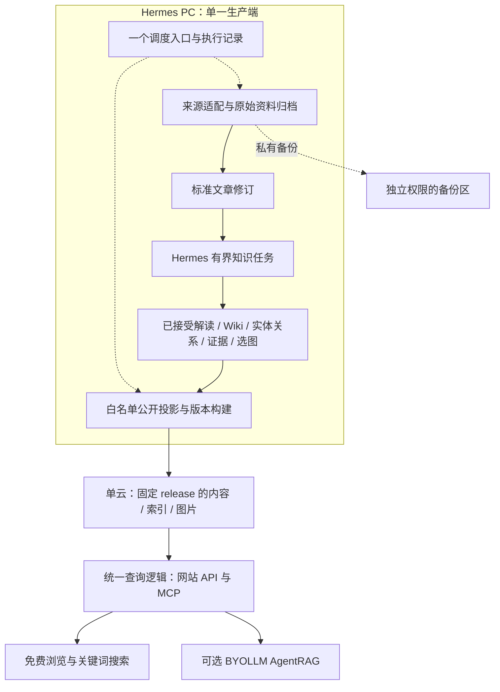

# VitaX 产品架构与执行计划

2026-09-10 修订。状态：用户已授权按最新讨论重新规划并开始实施；整体项目进行中。依据 [ADR 0001](../../adr/0001-pc-production-cloud-serving.md)、[ADR 0002](../../adr/0002-autonomous-repair-authority.md)、[ADR 0003](../../adr/0003-product-architecture-over-legacy-parity.md) 和 [ADR 0004](../../adr/0004-minimal-knowledge-product.md)。本版替代先前 A–E 顺序及研究报告中不同的默认组件建议。历史验证保留原有范围，不等于生产就绪。

## 1. 产品目标与精简原则

[KNOWN] Hermes PC 是知识生产唯一写入端；一台阿里云提供 VitaX 专业知识站、MCP、已发布知识副本和私有备份，vitaclaw-site 保持独立站点边界。每天 08:00 Asia/Shanghai 发布；匿名浏览和检索免费，复杂问题可以 BYOLLM 深度研究。Wiki、KG、图片与来源引用是产品能力；用户希望日常无需介入。

[INFERRED] Ponytail 顺序：不需要的功能不建；复用有效现有代码；优先标准库和平台能力；最后才增加依赖或最小实现。衡量总代码、模型调用、运维与质量，不把服务数量作为唯一指标。旧 pipeline 是材料，不是兼容规范；同样不能把“重构”当成全部重写的理由。

## 2. 单一目标架构

以下为 [INFERRED] 设计，不是部署现状。

[INFERRED] 原始内容、人工修订和已接受知识输出是长期资产；配方用于溯源，不保证重跑出相同知识。公开投影、FTS、向量和图引擎内部文件可重建。每个字段有一个主写位置：稳定身份/版本选择由内容目录管理，内容 artifact 不变，读库是发布派生物；不另建第二权威图库或双向同步的 Wiki 主库。

| 逻辑对象 | 最小合同 |
| --- | --- |
| SourceDocument | 稳定来源身份、原/规范 URL 与别名；抓取事件可多次，不用内容相同抹掉不同来源 |
| DocumentRevision | 内容版本与 hash、解析配方、原始捕获关联、段落/页/图定位；来源发布时间与抓取时间分开 |
| KnowledgeRevision | 实际接受的解读、Wiki、主张/关系及引用；允许多个原文版本、多条支持/反证；保留人工改动与模型配方 |
| PublishedRelease | 选中的公开知识/证据/资源/索引版本、发布时间和 manifest；请求固定一个 release |

[INFERRED] 历史缺失时间、模型或定位信息保存 unknown/null，不补造。事实有效期、内容修订、来源发布时间与站点发布时间不同；缺失证据的旧关系先保留为待核知识，不伪装为已验证公开事实。

### 公开边界与发布

[INFERRED] 默认发布来源元数据、已接受解读/专题/Wiki、必要引用摘录和按价值选取的图片及出处 caption。完整原文/全文翻译、原始 HTML/PDF、账户、Agent 轨迹、后台日志及凭据不默认公开。实体/关系/引用必须全部落在同一公开集合；跨向私有或缺失证据时拒绝发布，不静默删掉引用制造无来源答案。

[INFERRED] 私有备份与公开包分开构建和授权，不能把私有备份放进 Web 可读目录。构建新不可变版本，校验文件和引用后整体提升；失败保前版。请求先固定 release_id，再解析其数据库、向量集合和图片。在途请求设硬性处理期限，超过期限终止，不以浏览器会话存活延长旧版本。每个公开版本有明确到期时间；到期后新请求返回410并提示刷新当前版本，在途请求期限结束后方可回收其服务资源。具体期限随目标服务配置固定，并以缩短期限的候选测试验证；不建立跨用户会话注册表。撤下内容立即撤销相关旧版本的公开读取并清理受控缓存，用旧URL拒绝与缓存响应作为证据；已被外部下载的副本无法召回。私有备份按独立保留策略保存，不随公开到期永久删除。hash 校验不等于发布者认证。

### KG、Wiki 与 AgentRAG

[INFERRED] SQLite 保存明确的实体、别名、类型关系、主张与证据关联；先提供有界邻接和证据读取。不预建任意多跳路径、社区分析、全局主题图或泛化属性系统。Wiki 是带修订和引用的知识页面，进入普通检索；按受影响主题更新，不默认每个实体一页，不声称模型加工是确定性真值编译。

[INFERRED] AgentRAG 是可选的深度研究入口：搜索 → 阅读 → 按需查关系/补证 → 引用回答。先复用现有有界循环和客户端能力，不强制多角色流水线，不增加 Agent 框架。查询工具返回证据，外层负责综合；总轮数、工具次数、候选数、上下文量、时间和访客模型预算分别有界。`top_k` 或 `only_context` 单独不能证明所有这些边界。

[INFERRED] BYOLLM 覆盖查询规划、关键词抽取、补查与答案等全部查询侧模型步骤；key 只用于当前请求/会话，不进日志、库或任务队列，失败不使用站点 Key。IP 限流保护主机资源，不能替代生成预算。网站及 MCP 共用 release 和证据逻辑；公网站点不暴露管理/写入工具或私有跨用户查询历史。“可选”指访客选择是否深度研究，不是可从项目验收删除该能力；基础站点/云端候选可以先关闭BYOLLM运行，最终产品验收与退役旧高级检索仍依赖VX-010。

## 3. 组件裁决：每一项必须说明替代什么

本表为 [INFERRED] 实施决策，不是尚未运行的性能排名。

| 组件 | 本轮决定 | 替代或节省 | 准入边界 |
| --- | --- | --- | --- |
| Python 标准库 SQLite/JSON/文件操作 | 用于首个公开构建/读模型 | 一个可重建读库；无元数据数据库服务和 ORM | 中文分词质量仍待实测；不能用英文命中证明中文检索合格 |
| 现有 FastAPI 与 MCP SDK | 接同一组读函数 | 避免网站/MCP 双份业务逻辑和额外后端 | 到站点切片再接；不为离线首片提前建服务 |
| SQLite 业务图 | 实体/关系/证据合同确定 | 业务知识不被某图引擎独占 | 只做产品需要的有界查询，不自制通用图引擎 |
| LightRAG | 保留隔离对照与可复用路径 | 如果胜出，替代自写实体/关系召回和融合 | 不自动暴露原生公网 API；版本/权限/公开投影必须复核 |
| 现有 Qdrant 与 embedding 路径 | 首条链不迁移；只作现有对照 | 避免同时改算法、向量存储、模型空间 | 新公开服务需独立于 PC；不把本地旧部署视为已达标 |
| sqlite-vec / FastEmbed | 延后到质量/资源证据要求时 | 通过后可替代向量服务或较重查询编码运行时 | 覆盖实际实体/关系/chunk 向量职责及编码兼容；不预写 LightRAG adapter |
| 现有 CDP/来源适配、HTML/PDF 解析 | 先复用可验证路径 | 避免先重写所有抓取器 | 发现正文/图/表质量缺口才比较 Trafilatura、Docling/MinerU 等；每类只留胜出路径 |
| Hermes 与现有 Wiki 实现 | 复用任务路线与有价值校验 | 避免第二语义运行时和通用 Wiki 编译平台 | 适配新 revision/证据合同，保护人工修订；不用旧 APPLIED 代替内容验收 |
| 单一现有调度入口 | 默认；候选先手动运行 | 没有必要先装工作流服务 | Hermes cron/系统 timer 二选一管理同一批次；核实主机后选择 |
| Prefect | 不再是前置或优先实验 | 只有能替代明确重复调度代码才引入 | 不同时维护原调度器；不扩展恢复框架 |
| 用户提供的 React/Vite/Tailwind 站点 | 审阅后接真实数据 | 复用 UI，不另写一套站点 | 无 mock 成功回退，文章/Wiki/引用有可访问 URL，验证预渲染和 SEO |

[INFERRED] 当前不新增 Neo4j、Postgres、Cognee、RAGFlow、LangChain/LangGraph、Temporal、Celery/Redis、事件总线、实时复制或通用插件层。现有 SQLite 目录与 Qdrant 向量职责不同，不能只按“两种数据库”判定重复；最终不长期双跑两个相同职责的生产引擎。

## 4. 按可验收产品切片推进

[KNOWN] 两源知识/Wiki及公开读模型已完成本地切片验收。9月10日14:20–14:21 UTC只读盘点：三机按source+URL去重有1,257篇成功入库文章，1,216份数据库原文、1,203份全文译文；41篇缺数据库正文待查旧artifact。该数是快照，不是未来固定总数，也不包括全部图片/Wiki资产。证据见源码外 `vitax-candidate-runs/inventory-20260910/REPORT.md`。迁移、质量筛选和站点集成尚未执行。

[INFERRED] ask-matt路线采用既有规格→既有tracker子票→逐票实现与审阅；已明确的需求不重复访谈，不新增规划平台。以下顺序替代旧“导入与站点同轮全包”安排；技术依赖与资源优先级分别标明。

| 阶段 | 工单 | 可验收交付 | 依赖与退出门 |
| --- | --- | --- | --- |
| 已有基础 | VX-007/004/010内部切片 | 两源真实知识/Wiki、公开读库和内部取证 | 保留已有证据，不重跑无变化测试；父项仍partial |
| 1：下一大块 | VX-012A→VX-012B | 一篇→20篇旧资产零LLM导入，重跑/续跑与保全；全量长度和质量预览，规则校准；候选新进程读取 | 仅来源只读与隔离候选；至少一条真实旧合格知识可查；不是全量迁移 |
| 2：真实产品与规模 | VX-009A→009B；VX-012C | ZIP站点/HTTP/MCP用旧知识和新Wiki同版读取；同一入口全量候选迁移及逐条对账 | 009A技术上可立即开始，但资源优先阶段1；009B需012B+009A；012C需012B，二者可并行 |
| 3：高级检索 | VX-010 | BYOLLM真实补查/引用/预算/私有隔离；实测裁决引擎 | VX-009共享查询；先基础产品可用，不取消最终高级检索验收 |
| 4：独立云服务与自动生产 | VX-007完整包、008、011及004代表样本 | 页面/图片/索引同版发布；PC断开仍可查；08:00日更、阶段复用与备份恢复 | 已接受内容和查询；基础云候选可关闭BYOLLM，最终验收仍需010；复用迁移规范化/质量规则 |
| 5：生产切换 | VX-012父票 | 新增/变更追平，PC单写，停旧调度和重复服务，VitaX/MCP/vitaclaw-site分别验收 | 012C、008/010/011及恢复证据；现场重新核实与可回退切换 |

[INFERRED] 下一块预算2–3小时是执行上限，不是耗时承诺；只做阶段1。来源探查/长度分布与合成数据编码可互不阻塞；真实格式合同确定后用同一编码子代理接一篇再20篇。约150分钟停止新增功能、180分钟提交证据和断点，提前通过即结束。41篇恢复不成为所有完整文章的阻塞；找不到的逐条待核，不宣布丢失或完整迁移。

[INFERRED] VX-001/002 是具体远端动作的源码/环境核对，历史 preflight 不是现时证明。VX-003 已验证部分保留；VX-005 只处理仍影响现网的必要问题；VX-006 接真实故障时完成升级，不以重做合成恢复实验阻塞内容产品。

[INFERRED] 首片明确只交付离线公开读组件与内部取证修正，不宣称真实 ingestion、浏览器 UAT、模型质量或图增强等价已经完成。完整模型输出和生产目录不复制进源码；测试数据使用可公开/合成资料并注明来源性质。

## 5. 最多三个决定性验证

1. **真实知识生产质量。** 从已有来源取一篇贯通，再扩到约12篇中英/HTML/CDP/PDF/图表资料；以关键正文、数字、图片及引用预期验收解读、关系、Wiki更新。只对失败的解析/任务边界做小对照，不跑框架全排列。复用已有有效输出，记录实际用量或 unknown。样本规模不是统计充分性声明。
2. **检索与 AgentRAG 的增益。** 固定同一公开资料及独立审阅的参考证据，比较文章/Wiki基线与现有图增强，再只对有价值路径比较直接问答和有界补查。覆盖专名、缩写、版本、多跳、冲突、无答案；记录错引/漏证、延迟、模型费用、云端资源。需要替换向量或模型时先保持其它变量一致。结果决定引擎，不预设 LightRAG 必须退役或必须保留。
3. **发布与无人值守闭环。** 真实候选 release 上验证重复触发、阶段复用、坏版本拒绝、上一版继续可读、请求不混版本、PC断开云端可用、08:00时区、额度暂停、撤下内容不经旧URL泄露，以及私有备份恢复。只修实证缺口，不扩写通用恢复平台。

## 6. 迁移与执行边界

[INFERRED] 迁移、质量筛选、公开资格三种状态独立：原始资产全部保全；零LLM规则检查正文有效长度、壳页、重复和疑似译文残缺，输出原因和规则版本。200字符只沿用为初始短文提示，阈值由实际分布/样本校准；短公告、代码和图表不因长度自动淘汰，结构合格不等于专业价值或翻译质量已认证。筛选后引用不得悬空。

[INFERRED] 单篇、小批、全量和后续增量共用入口、稳定映射和进度记录，不建第二ETL/目录库。迁移模型请求为0；既有知识/译文直接保留。补翻译/知识加工另排队，按内容hash、任务、语言及模型/prompt/schema版本复用已接受结果，只处理变化或缺失项，未知用量不填0。

[INFERRED] 旧库是只读导入来源。先选小批现有文章/翻译/Wiki/图片/关系，与新内容进入同一合同；记录旧 ID/URL 到新 doc_id 与 revision 的映射。保留冲突、人工修订和多来源，不因 hash 相同删除出处。不兼容的索引再派生；不要求用新模型重算全部历史资产。无证据旧关系保留待核，不进入已验证公开事实。

[KNOWN] 编码采用用户要求的主控决策/拆分/验收、子代理执行；只派互斥写范围。当前目录有大量整理 WIP，保留原状；不得自动 commit/push、永久删除原始数据、不可逆迁移、改凭据或增加付费资源。生产变更绑定具体工单和当前验收，不整目录覆盖远端。

[INFERRED] 收口原则：首片通过就推进真实内容，不能为了更多 passing counts 重复合成探针。后续新组件必须写出它撤掉哪段代码/服务、改善哪个实际指标，以及不采用时的简单路径。
